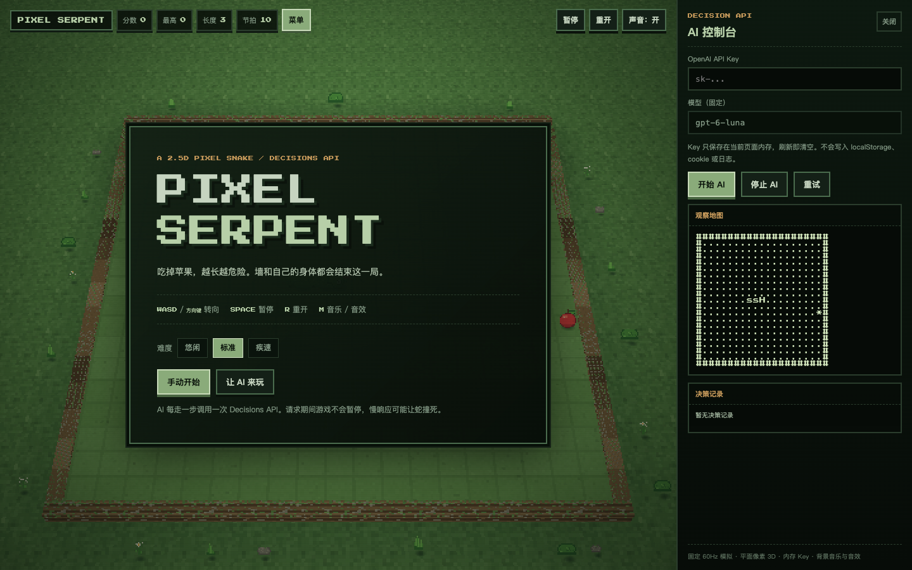
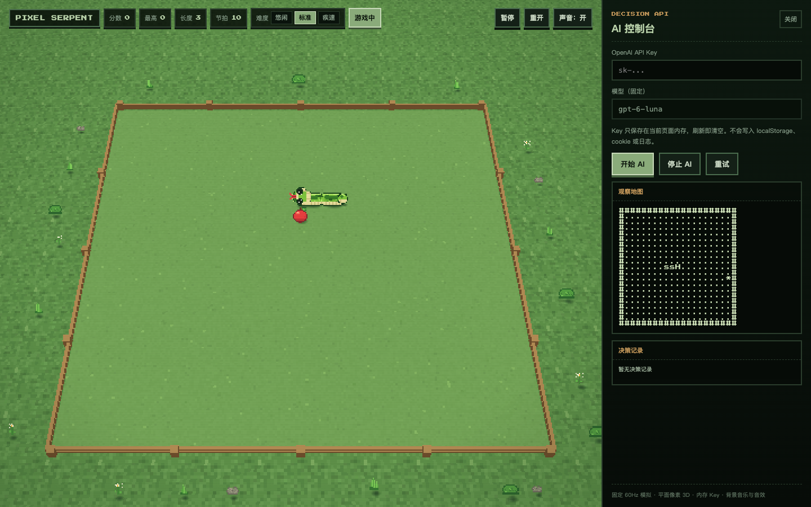
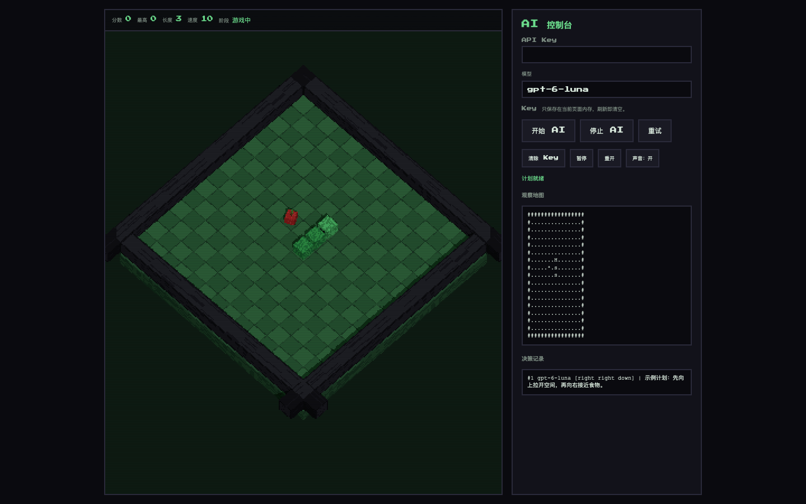

# PIXEL SERPENT

明亮 2.5D 像素贪吃蛇。固定 60Hz 模拟，Three.js 低分辨率平面贴片场景，Decisions API 返回类型化选择并控制蛇。







## 运行

```sh
npm install
npm run dev
```

打开终端给出的地址，默认是 `http://127.0.0.1:5173/`。

生产构建：

```sh
npm run build
npm run preview
```

## 操作

| 输入 | 动作 |
|---|---|
| `WASD` 或方向键 | 转向 |
| 按住场景并拖动 | 显示临时摇杆，中心在手指超出 36px 后跟随，沿弧线滑动平滑换向，松手收起 |
| `Space` | 暂停或继续 |
| `R` | 重开 |
| `M` | 开启或关闭音乐与音效 |
| 关闭按钮或右侧边缘标签 | 收起或重新打开 AI 控制台 |

规则是经典贪吃蛇。19x19 棋盘，撞墙或撞到身体结束。吃到苹果加 10 分并增长一格。手动模式每吃 6 个苹果，移动间隔减少 1 tick，直到达到当前难度的最快速度。AI 模式吃苹果时保持当前速度。顶栏和开局菜单的「难度」按钮组提供悠闲、标准、疾速三档，分别调整起始速度与最快速度。开局前就可以选。背景音乐由 Web Audio 程序化合成，不依赖外部音频文件。

## 视觉

场地保持正方向，只有透视俯视的仰角，没有 45 度旋转。地面是明亮的苔绿像素草地；可玩区是均匀的割草草地，没有格线，外圈是一圈低矮的木栅栏，立柱和两道横杆把边界清楚地标出来。栅栏内沿完全位于可玩格之外。

蛇头是独立的 32x32 像素角色，有额头、两侧的小黑眼和白色高光、奶白下颌、短红舌。蛇身由相互重叠的胶囊贴片连成一条连续身体，带亮绿顶面、中绿侧面、深绿下侧和窄奶白腹边；水平贴图是 25x18，竖直贴图是 18x20，旋转后像素不被拉伸。相邻段端部不画黑边，深绿大斑纹跨段延续；转弯处用软边接头填充，避免方形缺口。没有独立尾帽，身体在尾格自然收束。蛇、苹果和粒子都有偏移的扁平阴影，木栅栏也参与三维落点，所以角色仍是二维贴片，但落在三维场地里。AI 决策文本使用紧凑坐标和各方向的风险说明。

## 让 Decisions API 玩

1. 打开 AI 控制台，输入 OpenAI API Key。
2. 模型固定为 `gpt-6-luna`，对应 Decisions API。
3. 点「开始 AI」或菜单里的「让 AI 来玩」。

浏览器通过 `POST https://api.openai.com/v1/decisions` 请求当前方向。`input` 使用 `SNAKE/4 CURRENT`，包含当前棋盘、蛇身坐标、食物、移动速度、食物停留时间和响应延迟。每个方向的分析仅供 AI 判断。

```json
{
  "model": "gpt-6-luna",
  "input": "SNAKE/4 CURRENT\n... 当前棋盘、延迟和指标说明 ...",
  "questions": [
    {
      "type": "choice",
      "name": "next_move",
      "instructions": "Choose one current direction. Eat apples and stay alive ...",
      "choices": [
        { "value": "U", "description": "U (up): S1 LIKELY: safe_for=1500ms margin=900ms food_on_straight=none food_distance=4 space=358 tail=true" },
        { "value": "D", "description": "D (down): S1 LIKELY: safe_for=1500ms margin=900ms food_on_straight=2 food_distance=1 space=358 tail=true" },
        { "value": "R", "description": "R (right): S1 LIKELY: safe_for=1000ms margin=400ms food_on_straight=none food_distance=3 space=358 tail=true" }
      ]
    }
  ]
}
```

`U`、`D`、`L`、`R` 分别表示向上、向下、向左、向右。`answers[0].choice` 是一次方向输入，在响应到达后的下一次移动执行。模型每次只能返回一个方向。

关键行为：

- 游戏按固定 60 Hz 推进。开局、恢复游戏和执行完方向输入后，用当前棋盘请求 AI，同时最多一个请求。
- 所有符合转向规则的方向都会提供给 AI，包括会撞墙或撞身的方向。反向由游戏规则禁止。即使只有一个安全方向，也由 AI 选择。
- 等待响应或请求失败时，蛇按当前方向移动。AI 选择的危险方向照常执行，碰撞后游戏结束。
- 本地提供单步碰撞、可达空间、食物距离、直行余量和延迟分析。分析函数只返回信息，所有转向由 AI 输出。
- 暂停、重开或控制台修改棋盘时取消请求，防止旧响应改变新局面。
- Key 仅保存在页面内存中，启动 AI 后输入框清空。刷新页面需要重新输入。
- 网络或解析失败时显示错误，至少等待 60 tick，再在移动边界重试。

控制台的 `getPrompt()` 和 `getObservation()` 使用与真实请求相同的信息生成逻辑。`__snake.ai.getExecutionStats()` 区分 AI 方向输入、没有新输入时的移动，以及控制台脚本输入。

方向说明中的 `safe_for` 是选择该方向后，从第一次移动到直行碰撞的时间。`margin` 减去近期响应 P90，用来观察下一次响应是否可能来不及。`food_on_straight` 表示沿该方向直行时，第几步吃到已知食物。所有指标只供模型判断。

真实 API 的对照方法、逐局结果和限制见 [提示词实验报告](docs/ai-prompt-evaluation.md)。

## 控制台测试接口

页面始终暴露 `window.__snake`。所有会改状态的调用先停掉实时时钟，避免和 `requestAnimationFrame` 竞争。

```js
__snake.help()
__snake.start({ seed: 42 })
__snake.stepMoves(3)
__snake.getState()
__snake.getObservation().prompt
__snake.setDifficulty("fast")
__snake.getInvariantReport()
```

注入一个计划：

```js
__snake.ai.useMock({ moves: ["up", "right"], reason: "test" })
__snake.start({ seed: 42, ai: true })
__snake.stepMoves(2) // 请求在飞时蛇继续移动
await __snake.ai.waitForIdle(2000)
__snake.stepMoves(1)
__snake.getAiLog()
__snake.ai.getExecutionStats()
```

`attach()` 回到实时运行，`detach()` 停住模拟但保留渲染。完整命令和浏览器检查脚本见 [docs/testing.md](docs/testing.md)。

## 热路径

每帧和每个 tick 执行的代码使用 `.hot.ts`：

```text
src/engine/loop.hot.ts
src/sim/tick.hot.ts
src/sim/invariants.hot.ts
src/app/frame.hot.ts
src/render/scene.hot.ts
```

`npm run lint:hot` 禁止这些文件出现对象字面量、数组字面量、`new`、闭包、展开、模板字符串、`for...of` 和常见分配型调用。构建和检查都会执行它。

每个 tick 只推进时钟并跑位掩码不变量检查。真正的移动 reducer 在移动边界运行，每秒约 5 到 15 次。UI 只在版本变化时更新，不在每帧复制状态或生成观察文本。细节和边界见 [docs/hot-path.md](docs/hot-path.md)。

## 验证

```sh
npm test
npm run test:coverage
npm run lint:hot
npm run build
npm run verify:tla
npm run check
npm run test:browser
```

测试覆盖单方向输入、等待期间按当前方向移动、危险方向执行、请求取消和错误重试。真实浏览器检查通过 mock 运行完整控制链路，无需 API Key。

游戏状态的不变式在每一 tick 和每次状态改变后执行，生产构建也一样，名称与 TLA+ 对应。AI 请求的 `aiPending` 由会话测试和 TLA+ 覆盖。违规时游戏冻结并显示错误。

## 结构

```text
src/
  engine/    固定 60Hz 循环、输入、音频、种子 RNG
  sim/       GameState、规则、不变式、决策坐标与移动分析
  ai/        Decisions 传输、动态上下文、提示词、响应解析、方向控制器
  app/       会话状态机、内存 Key、控制台 API、帧热路径
  render/    Three.js 明亮平面像素场景、程序化纹理、纸片阴影
  ui/        DOM HUD、菜单、AI 面板
test/        与 src 同层级的 Vitest 测试
spec/        TLA+ 生命周期和规则模型
docs/        架构、测试、热路径、AI 延迟评估
```

引擎调度思路参考 tibo.dog 引擎研究：固定步长累加器、确定性 RNG、事件扇出、暂停时保留渲染、插值和对象池。玩法、场景和素材为本项目原创，不使用原游戏资产。

## 已知边界

- AI 成功路径需要你自己的 OpenAI Key。没有 Key 时可以用 mock 验证完整链路。
- AI 可能做出危险选择，网络延迟也可能让蛇在响应到达前碰撞。
- 延迟分析只使用当前可见的食物，新的食物位置在下一次实际观察时提供。
- 挂起请求没有自动超时。需要取消时，可暂停游戏或停止 AI。
- 浏览器直连 OpenAI 的非 2xx 错误可能被 CORS 隐藏成 `Failed to fetch`。
- 19x19 棋盘是这一版的全部玩法范围。没有关卡、障碍、皮肤或排行榜服务。
- 结束菜单提供「手动再来一局」和「AI 再来一局」。AI 重开复用内存里的 Key；没有 Key 时需要在右侧输入。
- 背景音乐是程序化循环。顶栏按钮同时切换音乐与音效的静音状态。
- 本项目不隶属于 OpenAI 或 tibo.dog。
